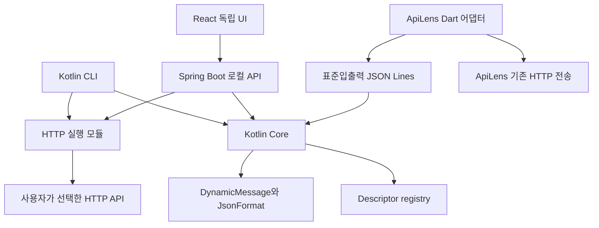

# mj_proto_assist 구현 설계서

작성일: 2026-10-29. 상태: 초기 구현 및 후속 설계. 제품 범위와 수용 기준은 [PRD](PRD.md)를 따른다.

## 2026-10-29 초기 구현 상태

이번 구현은 descriptor 기반 로컬 도구의 첫 동작 경로입니다. 아래의 원래 MVP 요구사항과 설계는 후속 목표도 포함하며, 표에 없는 기능의 완료를 뜻하지 않습니다.

| 요구사항 | 현재 구현과 검증 범위 | 남은 수용 기준 |
|---|---|---|
| F01–F04 | descriptor 등록·타입 탐색·encode/decode, import 의존성·중복·proto2 거절, int64·bytes·optional·oneof·map·중첩·unknown field 테스트 | .proto 컴파일 어댑터, 전체 WKT·Any·enum fixture 확대, 상세 오류 경로 |
| F05–F06 | HTTPS/명시 HTTP POST, bytes 보존, 타임아웃, 10MiB 상한, redirect·자동 재시도 없음, raw 결과·상태별 디코딩 | 실행 중 취소, 압축 응답 지원 |
| F07 | types·encode·decode·serve-stdio, 바이너리 stdout·진단 stderr 분리 | CLI call, 세분화 exit code |
| F08 | React UI, 동일 origin Spring Boot, bootstrap 세션·Origin/Host 검증, schema·편집·전송·오류·raw 탭 | 취소 UI, 세션 재접속 UX·자동 UI 회귀 테스트 확대 |
| F09 | 자동 저장 없음 | 컬렉션·환경변수 저장 및 재실행 전체 |
| I01/I02/C01 | IPC major 1 검사, 합성 fixture, stdio 변환 계약 테스트 | Dart 어댑터·실제 ApiLens/mj_fav·TypeScript 검증, 동시성·취소·재시작 |
| S01 | 로그에 대상 본문·헤더 미기록, 오류 원문 비반사, 로컬 인증·Origin 차단 테스트 | 공개 베타 전 추가 보안 검토 |

실행·테스트 절차는 [README](../README.md)를 따릅니다. 런타임 동봉 배포나 성능 목표 달성은 아직 주장하지 않습니다.


## 1 아키텍처 결정

서버는 특별한 사유가 없으면 Spring Boot + Kotlin을 사용한다. 공통 변환 Core와 CLI도 Kotlin/JVM으로 구성한다. ApiLens가 Flutter/Dart 기반이므로 TypeScript 패키지를 직접 삽입하는 방식 대신 로컬 보조 프로세스와 언어 중립 IPC를 선택한다.



Core에는 네트워크·UI·파일 탐색 의존성을 넣지 않는다. raw bytes와 타입 이름을 전달하면 변환 결과를 반환하는 순수 경계를 유지한다. 파일·컴파일러 실행은 schema-loader, 네트워크는 http-runner, 저장은 workspace 모듈에서 처리한다. 독립 UI와 ApiLens가 각자 다른 파서를 구현하지 않게 한다.

## 2 모듈과 저장소 구조

```text
contracts/             # IPC·관리 API JSON Schema, 공개 오류 코드
core/                  # Kotlin descriptor registry, codec, validation
schema-loader/         # descriptor 로딩, protoc 실행 어댑터
http-runner/           # POST 실행, 시간·상태·raw bytes
workspace/             # 컬렉션·환경 참조, 저장 마이그레이션
cli/                   # Kotlin CLI와 serve-stdio
local-api/             # Spring Boot loopback 서버
ui/                    # React TypeScript UI
adapters/apilens/      # Dart 연동 계약·예제, 실제 ApiLens 변경은 별도
examples/              # 합성 proto·JSON·오류 응답
fixtures/              # 언어 간 상호운용 golden 데이터
scripts/               # 문서·fixture 검증, 향후 패키징
```

현재 core/, cli/, local-api/, ui/를 구현했다. 그 외 모듈과 아래 미검증 기능은 후속 구조다. Gradle Kotlin DSL을 사용하고 Java·Kotlin·Spring·protoc·Protobuf 런타임 버전은 구현 착수 시 호환 표를 검증해 고정한다. Node.js는 독립 UI 빌드·테스트용이며 Kotlin 실행부의 런타임은 JVM이다.

## 3 데이터 계약

### 3.1 스키마 등록

기본 입력은 imports를 포함한 `FileDescriptorSet`이다. `.proto`는 사용자가 지정한 import 루트와 함께 protoc로 컴파일한다. protoc 미설치·버전 미지원은 설치 안내와 descriptor 입력 대안으로 처리하고 자동 다운로드하지 않는다. 플러그인 실행과 소스 코드 생성은 필요 없다.

schemaId는 descriptor set 원본 바이트와 loader 정책 버전의 SHA-256으로 산출한다. 의미가 같은 파일도 바이트가 다르면 다른 ID가 될 수 있으며 내용 동등성을 주장하지 않는다. 파일 의존성을 위상 순서로 해석해 FileDescriptor와 전체 이름별 Descriptor를 만든다. 중복 심벌·import 누락·지원하지 않는 syntax는 등록 실패다. 새 registry를 완성한 뒤 원자적으로 교체한다.

proto 파일은 지정 루트 내부만 읽는다. 경로 정규화와 symlink 실경로 확인으로 import 탈출을 막고, 인자는 shell 문자열이 아닌 배열로 전달한다. 프로세스 타임아웃·출력 크기·파일 수 제한을 둔다. WKT는 검증된 컴파일러 include 또는 포함된 descriptor를 사용하고 정의가 충돌하면 거절한다.

### 3.2 코덱

공개 Core 인터페이스의 개념형은 다음과 같다.

```text
register(descriptorBytes) -> SchemaHandle
listTypes(schemaId) -> MessageType[]
inspectType(schemaId, fullName) -> TypeDescription
encode(schemaId, fullName, protoJson) -> bytes + warnings
decode(schemaId, fullName, bytes) -> protoJson + warnings
release(schemaId) -> result
```

schema 없이 field number만 보여주는 raw decode는 후속 진단 기능이다. MVP는 타입을 반드시 요구한다. 코덱은 DynamicMessage와 JsonFormat을 사용하고 well-known types 및 Any의 TypeRegistry를 같은 registry에서 구성한다. 등록되지 않은 Any type URL은 네트워크로 가져오지 않고 오류로 표시한다.

ProtoJSON을 그대로 사용한다. int64·uint64는 문자열로 취급해 JavaScript 정밀도 손실을 막고 bytes는 Base64로 표현한다. oneof 동시 지정과 알 수 없는 JSON 필드는 기본 거절한다. optional 값 미지정·기본값·명시적 제거는 API별 계약에서 구분하며 임의로 기본값을 채우지 않는다.

unknown binary field는 Core의 원본 메시지와 raw bytes에 남기고 JSON 표시에는 `UNKNOWN_FIELDS_PRESENT` 경고를 붙인다. JSON을 편집·재인코딩하면 unknown field를 보존한다고 약속하지 않는다. decode와 encode 결과의 바이너리 완전 일치보다 알려진 필드 값·presence 일치를 검증한다.

### 3.3 요청 컬렉션

```text
Collection: formatVersion, name, schemaRefs[], requests[]
Request: id, name, urlTemplate, method=POST, headers,
         requestType, responseRules[], schemaRef, protoJson,
         timeoutMs, environmentRef
ResponseRule: statusMatch, mediaType, messageType
```

schemaRef는 논리 이름·descriptor hash·로컬 상대 경로를 기록한다. 다른 컴퓨터에서 경로가 없으면 재연결을 요구하며 다른 schema로 조용히 대체하지 않는다. 저장된 schema와 현재 해시가 다르면 전송 전에 경고한다. 자격증명은 `${TOKEN}` 같은 환경 참조로 저장하고 값은 기본 저장·내보내기에서 제외한다.

## 4 보조 프로세스 IPC

### 4.1 프로토콜 선택

ApiLens와의 제어 통신은 UTF-8 JSON Lines다. 이것은 **개발 도구 내부 계약**이며 대상 API의 Protobuf 통신과 별개다. 시작 시 보조 프로세스는 네트워크 포트를 열지 않고 stdin으로 명령을 받고 stdout으로 응답을 보낸다. 진단은 stderr 전용이다.

```json
{"id":"r1","protocolMajor":1,"method":"codec.decode","params":{"schemaId":"...","messageType":"sample.v1.Reply","payloadBase64":"..."}}
```

```json
{"id":"r1","result":{"protoJson":{"revision":"9007199254740993"},"warnings":[]}}
```

오류는 `{id,error:{code,message,path,retryable}}`다. 한 요청에는 최종 응답을 한 번만 보내고 payload 원문을 오류 message에 반사하지 않는다. 응답 순서를 요청 순서와 동일하다고 가정하지 않고 id로 연결한다. JSON의 64비트 필드는 문자열을 유지한다.

### 4.2 메서드와 수명주기

| 메서드 | 역할 |
|---|---|
| `system.hello` | protocol major/minor, 제품 버전, 기능, 한도 협상 |
| `schema.register` | descriptorBase64 등록; proto 경로 등록은 신뢰된 로컬 요청에서 별도 입력 |
| `schema.listTypes` | 타입 목록과 페이지 커서 |
| `schema.inspectType` | 필드·enum·oneof·presence 설명 |
| `schema.release` | 참조 해제와 메모리 회수 |
| `codec.encode` | ProtoJSON에서 binary Base64 생성 |
| `codec.decode` | binary Base64에서 ProtoJSON 생성 |
| `request.cancel` | 대상 id 취소 요청 |
| `system.shutdown` | 정상 종료 |

ApiLens는 실행 파일을 사용자가 지정하거나 배포 검증된 위치에서 선택하고 shell 없이 시작한다. hello 시간 초과·프로토콜 major 불일치 시 연결하지 않는다. minor 증가는 선택 기능만 추가하며 클라이언트는 알 수 없는 필드를 무시한다. 비정상 종료 시 진행 작업은 실패로 끝내고 재시작 후 schema를 다시 등록한다. HTTP 요청을 자동 재실행하지 않는다.

stdin EOF면 자원을 닫고 종료한다. 프로세스별 bounded queue·동시 변환 수·전체 registry 메모리 상한을 둔다. 기본 본문 10MiB를 Base64와 JSON으로 감쌀 수 있도록 line 상한은 16MiB, 요청 동시 수는 4, 등록 스키마 총량은 64MiB를 초기 제안값으로 둔다. decoder는 바이트·재귀 제한을 먼저 적용한다. 취소는 best effort이며 취소 완료 후 늦은 결과가 도착하면 어댑터에서 폐기한다.

ApiLens MVP는 encode/decode만 IPC에 위임하고 기존 Dio가 HTTP 전송을 담당한다. 독립 도구용 HTTP 실행 기능을 IPC로 무조건 노출하지 않는다. 향후 노출 시 capability와 보안 경계를 별도 검토한다.

## 5 대상 API 통신

대상 API는 기본적으로 HTTPS POST다. `Content-Type`·`Accept` 기본값은 Spring 호환을 위해 `application/x-protobuf`로 두되 프로젝트별 `application/protobuf` 설정도 허용한다. 직렬화한 바이트를 문자열로 변환하지 않고 그대로 전송한다. 응답도 bytes로 수신한다.

HTTP 상태 코드와 본문 해석은 분리한다. 상태별 명시 규칙, `2xx`/`4xx`/`5xx` 규칙 순서로 타입을 선택한다. 공통 ApiError는 예제일 뿐 모든 서버의 오류 schema를 강제하지 않는다. 오류 타입이 없거나 content type이 예상과 다르면 raw bytes·제한된 text preview를 보여준다. 빈 본문은 디코딩을 시도하지 않는다. HTML 오류를 Protobuf로 무조건 해석하지 않는다.

redirect는 기본 추적하지 않는다. 켜더라도 다른 origin으로 Authorization·Cookie를 자동 전달하지 않는다. 타임아웃·취소·TLS 실패·디코딩 실패는 서로 다른 코드다. POST는 자동 재시도하지 않는다. 사용자가 재실행하면 requestId나 Idempotency-Key는 대상 API 계약에 맞춰 유지·갱신할지 선택한다. 도구가 임의로 멱등성을 보장하지 않는다.

독립 runner는 HTTPS를 기본으로 하고 로컬 개발용 HTTP는 사용자가 명시적으로 허용한다. TLS 인증서 검증은 기본 활성화한다. 사설망·localhost 호출은 개발 도구의 정상 사용 사례로 허용하되 대상 주소를 표시하고 사용자가 실행한 요청만 전송한다. URL userinfo·비HTTP scheme은 거절한다. 응답 상한은 압축 해제 이후 바이트에도 적용한다.

## 6 독립 UI와 로컬 API

React UI는 Spring Boot가 동일 origin에서 제공한다. 로컬 API는 `127.0.0.1` loopback에만 bind하고 임의 포트를 사용한다. 시작 시 발급한 일회용 bootstrap 값을 URL fragment로 전달해 세션을 교환하고 fragment는 즉시 지운다. 세션은 메모리 또는 HttpOnly·SameSite 쿠키에 두며 디스크에 영구 저장하지 않는다.

임의 웹사이트가 로컬 API를 호출하지 못하도록 세션 인증, Origin·Host allowlist, CORS 거절, CSRF 검증을 적용한다. 상태 변경은 POST, 요청 본문·파일 접근은 명시 동작에 한정한다. 로컬 API의 JSON 관리 계약은 디버깅 편의성을 위한 내부 규약이며 대상 API의 POST+Protobuf 정책과 별개다.

| 로컬 API | 요청과 결과 |
|---|---|
| `POST /local/v1/session` | 일회용 bootstrap 교환 |
| `POST /local/v1/schema/register` | descriptor 업로드와 schemaId 반환 |
| `POST /local/v1/schema/types` | schemaId로 타입 조회 |
| `POST /local/v1/codec/encode` | schema·타입·JSON으로 Base64 결과 |
| `POST /local/v1/codec/decode` | schema·타입·Base64로 JSON 결과 |
| `POST /local/v1/http/execute` | 명시 요청 실행과 raw/decoded 결과 |
| `POST /local/v1/workspace/save` | 비밀 제외 컬렉션 저장 |

JSON 경로를 통해 임의 파일을 읽는 API를 제공하지 않는다. `.proto` import는 명시 선택된 workspace 루트 아래만 허용한다. 요청 본문은 브라우저 저장소에 자동 저장하지 않는다. UI는 request/response 타입·선택 schema·전송 환경을 고정 표시하고 JSON과 raw bytes 탭을 제공한다.

## 7 CLI 계약

아래는 목표 CLI 계약이다. 현재 types·encode·decode·serve-stdio만 구현했으며 실행 경로는 README를 따른다.

```text
proto-assist types --descriptor schema.pb
proto-assist encode --descriptor schema.pb --type sample.v1.Request --in request.json --out request.bin
proto-assist decode --descriptor schema.pb --type sample.v1.Reply --in response.bin --out response.json
proto-assist call --collection sample.json --request echo --env-file local.env
proto-assist serve-stdio
proto-assist ui
```

기본 실행 파일명은 `proto-assist`, 저장소명은 `mj_proto_assist`로 구분한다. stdin/stdout pipe를 지원하고 바이너리 출력 시 상태 문구는 stderr로만 보낸다. 초기 exit code는 0 성공, 2 인자·schema·입력 검증, 3 HTTP/네트워크, 4 디코딩, 5 IPC/내부 오류다. HTTP 비2xx는 CLI code 3이지만 본문 디코딩 결과도 별도 출력 파일에 보존할 수 있다. 파괴적 요청의 자동 반복 옵션은 MVP에 두지 않는다.

## 8 보안과 데이터 수명

기본 로그는 요청 id·오류 코드·소요시간·크기뿐이다. Authorization·Cookie·Set-Cookie·토큰·본문·파일 원문·URL 쿼리는 기록하지 않는다. 오류 text preview도 세션 화면에만 표시하고 기본 로그나 컬렉션에는 저장하지 않는다. 마스킹되지 않은 원본은 메모리에 존재하므로 마스킹이 암호화나 완전한 비밀 탐지를 뜻하지 않음을 안내한다.

컬렉션 자동 저장에는 설정과 비밀 참조만 남긴다. payload 저장·raw export는 사용자 선택으로 하고 포함 항목을 표시한다. 환경 파일은 VCS에서 제외하고 실제 키 대신 예제 변수만 공개한다. 원격 schema import, 자동 코드 실행, protoc plugin 실행을 금지한다.

기본적으로 원격 호출 기능을 가진 공개 서비스로 운영하지 않는다. 로컬 HTTP runner를 네트워크에 공개하면 임의 대상 호출 위험이 생기므로 공개 바인딩 옵션은 MVP에서 제공하지 않는다. 이 도구는 Protobuf 데이터를 암호화하지 않으며 전송 보호에는 HTTPS가 필요하다.

## 9 검증과 배포

| 경계 | 검증 |
|---|---|
| Core | int64·bytes·enum·optional·oneof·map·WKT·Any·잘못된 입력·unknown field |
| loader | import 순서·중복 심벌·지원 안 하는 syntax·경로 탈출·컴파일 타임아웃 |
| HTTP | Kotlin 테스트 서버 echo, 400 protobuf·500 HTML·204 빈 본문·redirect·취소·크기 초과 |
| IPC | 분할 입력·복수 요청·잘못된 JSON·중복 id·프로세스 종료·major 불일치·Base64 제한 |
| UI | schema 교체·인코딩 오류·전송 중 취소·오류 디코딩·비밀 제외 내보내기 |
| ApiLens | Dart codec 어댑터, bytes 보존, 기존 JSON 요청 회귀 없음 |
| mj_fav | 합성 동기화·요약·오류 계약의 Kotlin/TypeScript 상호운용 |

JUnit 기반 Core·HTTP·IPC 테스트와 TypeScript·Dart fixture 검증을 사용한다. 문서 단계에서는 테스트 통과나 성능 측정을 주장하지 않는다. 배포는 JVM CLI와 Spring Boot 실행 패키지를 먼저 검증하고 추후 jpackage 등 런타임 동봉 배포를 평가한다. GraalVM native image·FFI·WASM은 필수 조건으로 삼지 않는다.

릴리스에 protocol major/minor, schema 지원 범위, Protobuf 런타임·컴파일러 버전, OS별 검증 결과를 기록한다. 실행 파일·배포물은 체크섬과 생성 과정을 공개하고 서명·배포 채널은 첫 바이너리 릴리스 전 결정한다. MIT LICENSE와 의존성 라이선스 고지를 함께 배포한다.
